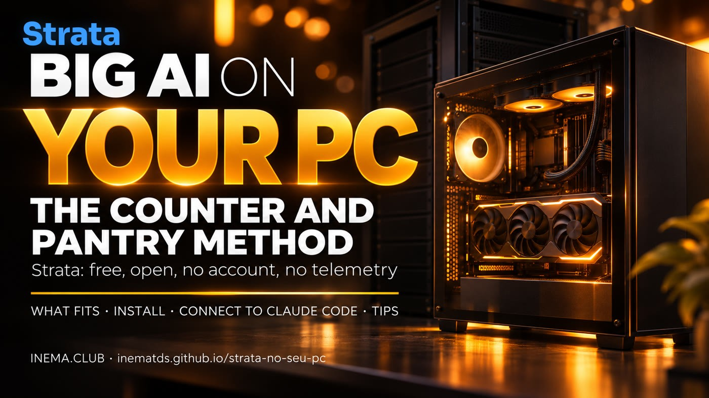

# 🧠 strata-no-seu-pc

[](https://linnoff88-dev.github.io/arckhe-/guia/en/)

**🇧🇷 [Português](README.md) · 🇺🇸 [English](README.en.md) · 🇪🇸 [Español](README.es.md)**

## What it is

You want to use AI without paying for every question and keep your files on your computer. Strata is a free, open-source engine that splits a large AI model across your graphics card, memory, and storage. This kit helps you choose a size and connect your tools, based on the official documentation. You need compatible hardware, memory, and space for the model; if you have Windows or Mac and just want to chat, you can use the app and skip the technical section.

## 📖 User guide

https://linnoff88-dev.github.io/arckhe-/guia/en/

Free public kit from ARCKHÉ AI. Method: **counter and pantry**.
**We did not run anything here: this is the organized official documentation.** Figures come from the project or its community.
[Official Strata](https://github.com/Niko1221/Strata) — open-source engine, MIT license; models have their own licenses.

## Files

- [DICAS.en.md](DICAS.en.md): tips, pitfalls, and common problems.
- [TABELA.en.md](TABELA.en.md): memory, sizes, and limits.
- [CONECTAR.en.md](CONECTAR.en.md): Claude Code, Codex CLI, OpenCode, and access with a key.
- [Checklists](checklists/): [before installing](checklists/antes-de-instalar.en.md), [Windows](checklists/instalar-windows.en.md), [Linux/Mac](checklists/instalar-linux-mac.en.md), [DGX Spark](checklists/dgx-spark.en.md).
- [qual_tamanho.sh (in Portuguese)](ferramentas/qual_tamanho.sh): hardware readout, no installation.
- [FATOS.md (in Portuguese)](FATOS.md) and [docs-oficiais/](docs-oficiais/): local sources.

## The process, from start to finish

1. 🧠 Understand the kitchen: graphics card on the counter, RAM in the pantry, SSD in the basement.
2. ⚙️ Script: if you run it in Bash, it reads RAM, NVIDIA VRAM, architecture, and disk; it suggests candidates without installing anything.
3. 🧠 Check the table, compatible hardware, and available space; choose a size with room to spare.
4. 🧠 Download the app or run the official installer and choose a model. Strata downloads and prepares the files.
5. 🧠 Run `strata connect`, review the configuration, authorize saving with a backup, and check the connection.
6. 🤖 AI: the local model responds on your computer. Review the responses and control access and tools.

According to the official README, DeepSeek V4.1-Flash 2.00 bpw on an RTX 5070 12 GB + 64 GB RAM produces 4–6 tokens/s. This is a project measurement, not a measurement of this kit. ([README](docs-oficiais/strata-README.md)).

The script uses Bash; translated output with QT_LANG=en or QT_LANG=es also requires Python 3 to be installed. Without QT_LANG, the default is Portuguese.

```sh
QT_LANG=en bash ferramentas/qual_tamanho.sh
```
