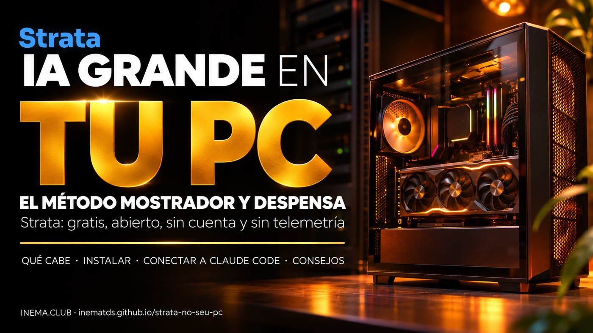

# 🧠 strata-no-seu-pc

[](https://inematds.github.io/strata-no-seu-pc/guia/es/)

**🇧🇷 [Português](README.md) · 🇺🇸 [English](README.en.md) · 🇪🇸 [Español](README.es.md)**

## Qué es

Quieres usar IA sin pagar por cada pregunta y mantener tus archivos en tu computadora. Strata es un motor gratuito y de código abierto que divide una IA grande entre la tarjeta gráfica, la memoria y el almacenamiento. Este kit te ayuda a elegir un tamaño y conectar tus herramientas con base en la documentación oficial. Necesitas hardware compatible, memoria y espacio para el modelo; si tienes Windows o Mac y solo quieres conversar, puedes usar la aplicación y saltarte la parte técnica.

## 📖 Guía de uso

https://inematds.github.io/strata-no-seu-pc/guia/es/

Kit público y gratuito de INEMA.CLUB. Método: **mostrador y despensa**.
**No ejecutamos nada de esto: es la documentación oficial organizada.** Las cifras son del proyecto o de su comunidad.
[Strata oficial](https://github.com/Niko1221/Strata) — motor de código abierto, licencia MIT; los modelos tienen sus propias licencias.

## Los archivos

- [DICAS.es.md](DICAS.es.md): consejos, trampas y problemas frecuentes.
- [TABELA.es.md](TABELA.es.md): memoria, tamaños y límites.
- [CONECTAR.es.md](CONECTAR.es.md): Claude Code, Codex CLI, OpenCode y acceso con clave.
- [Checklists](checklists/): [antes de instalar](checklists/antes-de-instalar.es.md), [Windows](checklists/instalar-windows.es.md), [Linux/Mac](checklists/instalar-linux-mac.es.md), [DGX Spark](checklists/dgx-spark.es.md).
- [qual_tamanho.sh (en portugués)](ferramentas/qual_tamanho.sh): lectura de hardware, sin instalación.
- [FATOS.md (en portugués)](FATOS.md) y [docs-oficiais/](docs-oficiais/): fuentes locales.

## El proceso, de principio a fin

1. 🧠 Entiendes la cocina: tarjeta en el mostrador, RAM en la despensa, SSD en el sótano.
2. ⚙️ Script: si lo ejecutas en Bash, lee la RAM, la VRAM de NVIDIA, la arquitectura y el disco; sugiere opciones sin instalar nada.
3. 🧠 Revisas la tabla, el hardware compatible y el espacio; eliges un tamaño con margen.
4. 🧠 Descargas la aplicación o ejecutas el instalador oficial y eliges el modelo. Strata descarga y prepara los archivos.
5. 🧠 Usas `strata connect`, revisas la configuración, autorizas guardarla con una copia de seguridad y verificas la conexión.
6. 🤖 IA: el modelo local responde en tu computadora. Revisas las respuestas y controlas el acceso y las herramientas.

Según el README oficial, DeepSeek V4.1-Flash 2.00 bpw en la RTX 5070 12 GB + 64 GB de RAM produce 4–6 tokens/s. Es una medición del proyecto, no de este kit. ([README](docs-oficiais/strata-README.md)).

El script usa Bash; la salida traducida con QT_LANG=en o QT_LANG=es también requiere tener instalado Python 3. Sin QT_LANG, el idioma predeterminado es portugués.

```sh
QT_LANG=es bash ferramentas/qual_tamanho.sh
```
